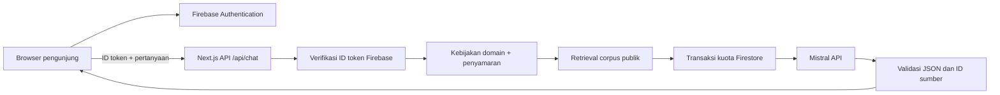

# Arsitektur dan kontrak



Landing dan dokumen informasi dapat diakses publik. Chat memakai Firebase ID token pada Authorization Bearer. Token diperiksa server; identitas tidak diambil dari UID yang dikirim client. Sesi tamu memakai Firebase Anonymous Auth, bukan password bersama. UI login/register dan chat adalah client components; landing dan dokumen adalah server components.

## Jalur jawaban

1. Periksa origin, identitas Firebase, format dan panjang payload.
2. Samarkan pola rahasia pada pesan dan konteks.
3. Tanggapi sapaan, penolakan, pertanyaan ambigu, dan akses terbatas secara deterministik. Jalur ini tidak mengaku sebagai jawaban model.
4. Cari hingga dua sumber yang cocok. Tidak ada sumber berarti no-answer; tidak ada fallback ke pengetahuan bebas model.
5. Ambil kuota melalui satu transaksi Firestore untuk tiga bucket: pengguna/menit, hash IP/jam, dan global/hari.
6. Kirim sumber dan maksimum enam pesan konteks ke Mistral, timeout 25 detik, maksimum 700 output token, temperature 0. JSON Schema membatasi struktur dan ID sumber.
7. Validasi hasil, panjang teks, dan referensi. URL model ditolak; tautan hanya diambil dari metadata sumber server.
8. Kembalikan jawaban dan sumber. Model timeout, 429, atau format tidak valid menghasilkan error yang bisa dicoba lagi, bukan jawaban buatan.

Pembatasan ID sumber tidak membuktikan groundedness setiap kalimat. Evaluasi manusia terhadap kecukupan sumber tetap diperlukan. Prompt injection dan penyamaran merupakan mitigasi berlapis, bukan jaminan sempurna.

Khusus artikel FAQ ber-ID `demo-*`, JSON Schema membatasi `answer` ke enum teks sumber. Server menolak hasil yang tidak persis sama atau tidak cocok dengan ID sumber, lalu menambahkan label belum disahkan. Response memakai `engine: curated`; UI menyatakan contoh terkurasi yang dipilih Mistral. Teks perusahaan tetap memakai `engine: mistral`. Ini mencegah parafrase FAQ menambahkan langkah yang belum ada di materi.

## API

`POST /api/chat`

Header: `Authorization: Bearer <Firebase ID token>` dan `Content-Type: application/json`. Browser harus memakai origin yang sama. Origin HTTP hanya diizinkan pada development.

```json
{
  "message": "Apa itu PNM Mekaar?",
  "history": [{ "role": "user", "content": "Saya ingin mengenal PNM" }]
}
```

Pesan 1–1.200 karakter; payload maksimum 16.000 karakter; history hanya role user/assistant, dipotong menjadi enam pesan masing-masing 1.200 karakter. Tidak menerima role system dari browser.

```json
{
  "answer": "...",
  "kind": "answer",
  "engine": "mistral",
  "sourceIds": ["mekaar"],
  "sources": [
    { "id": "mekaar", "title": "PNM Mekaar", "status": "Sumber publik PNM" }
  ]
}
```

| Status  | Makna                                                                        |
| ------- | ---------------------------------------------------------------------------- |
| 200     | Jawaban model atau respons kebijakan dengan label engine yang sesuai         |
| 400/413 | Input tidak valid atau terlalu panjang                                       |
| 401     | Identitas tidak valid; masuk kembali                                         |
| 403     | Origin tidak diizinkan                                                       |
| 429     | Kuota demo atau provider membatasi permintaan                                |
| 503     | Provider/penyimpanan kuota belum tersedia; tidak memanggil model tanpa kuota |

## Data

Firestore hanya memiliki `quota/{opaque-window-id}` dengan `count` dan `expiresAt`. Semua client read/write ditolak. Server memakai service account khusus berperan Datastore User. Riwayat dan feedback berada pada `sessionStorage` per UID; tidak ada koleksi percakapan publik.

ID bucket menggunakan SHA-256 untuk menghindari menyimpan IP mentah, tetapi hash tanpa salt bukan anonimisasi mutlak. Counter memiliki waktu kedaluwarsa logis; pembersihan fisik dilakukan melalui prosedur operasi. TTL berbayar tidak diaktifkan.

## Batas arsitektur demo

Tidak ada SSO PNM, ACL pegawai, akses SOP internal, ticketing, streaming token, file upload, vector database, fine-tuning, atau integrasi transaksi. Tidak ada data nyata yang dibutuhkan untuk presentasi. Production enterprise memerlukan tata kelola konten, audit, retensi, monitoring, dan kontrol akses tersendiri.
